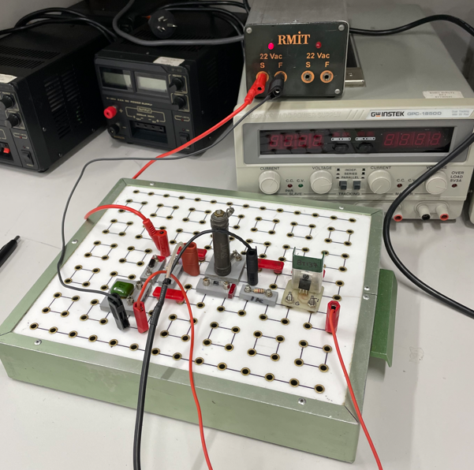
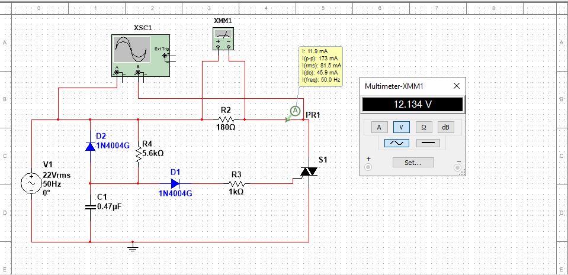
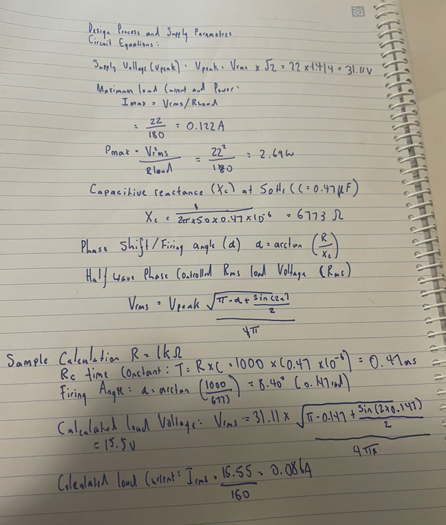
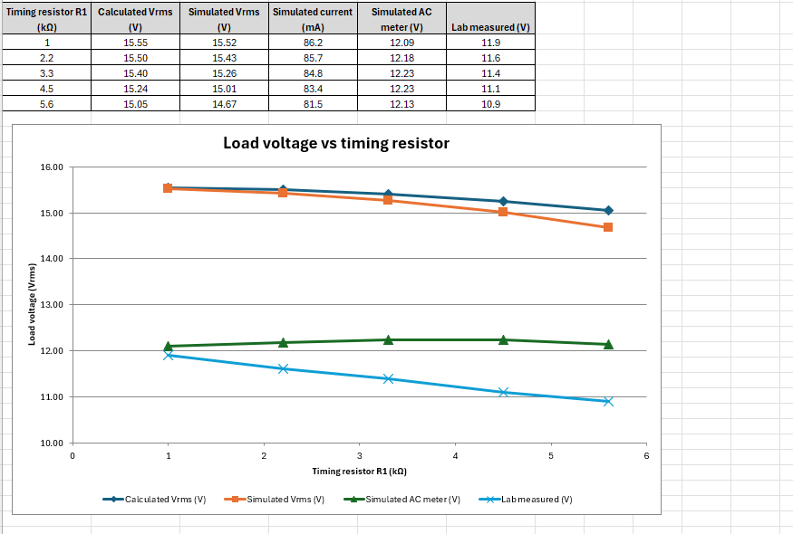
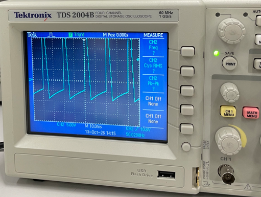
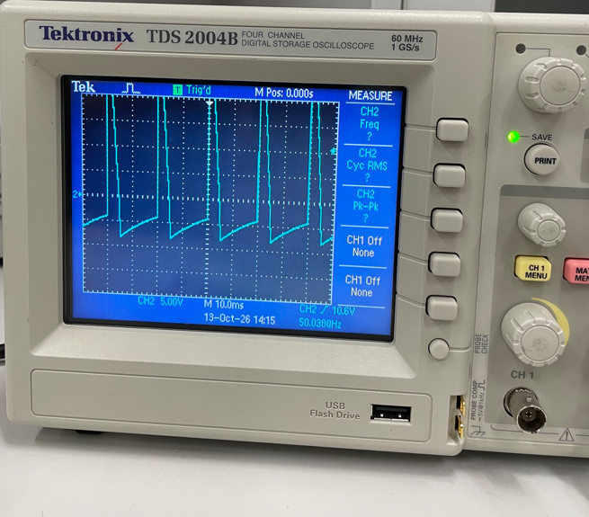
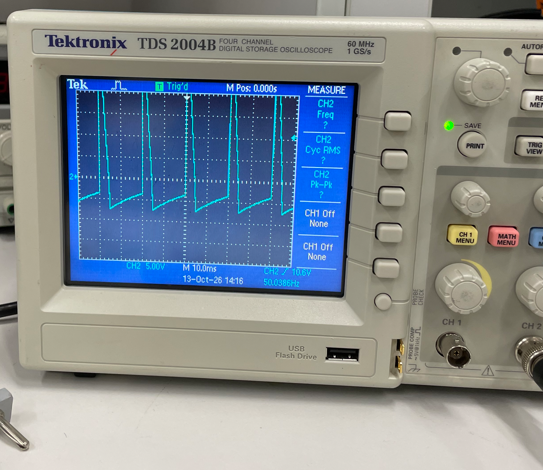
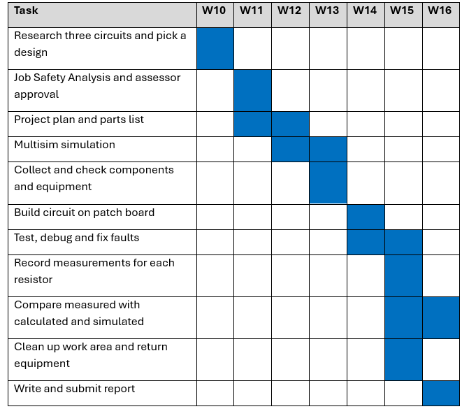

# Triac AC Phase-Control Circuit (BT137)

A single-phase AC power controller. A **BT137 triac** and an **RC timing network** set how far into each AC half-cycle the triac fires. That controls the RMS voltage delivered to the load. I designed the circuit, calculated the firing angle and output voltage, simulated it in **Multisim**, then built it on the bench and measured it with an oscilloscope and a multimeter.

Built for *UEEIC0042 Solve problems in single phase electronic power control circuits* (Advanced Diploma of Electronics and Communications Engineering, RMIT, 2026).



## How it works



- The 22 Vac, 50 Hz isolated bench supply feeds a **180 Ω load** through the triac.
- At the start of each positive half-cycle, the **0.47 µF capacitor** charges through the **timing resistor**.
- When the capacitor voltage is high enough, current flows through diode D1 and a 1 kΩ gate resistor into the triac gate. The triac turns on and powers the load for the rest of the half-cycle.
- Diode D2 discharges the capacitor on the negative half-cycle, so every cycle starts from the same point.
- **A bigger timing resistor** makes the capacitor charge more slowly, so the triac fires later and the load gets **less voltage**.

## Design calculations

| Parameter | Value |
|---|---|
| Supply | 22 Vrms, 50 Hz → V<sub>peak</sub> = 22 × √2 = **31.1 V** |
| Max load current | 22 / 180 = **0.122 A** |
| Max load power | 22² / 180 = **2.69 W** |
| Triac rating | BT137: 600 V, 8 A, far above what's needed |
| Capacitor reactance | X<sub>C</sub> = 1 / (2π·50·0.47 µF) = **6773 Ω** |

Firing angle and RMS load voltage (half-wave phase control):

```
α     = arctan(R / Xc)
Vrms  = Vpeak · sqrt( (π − α + sin(2α)/2) / (4π) )
```

Worked example for R = 1 kΩ: τ = RC = 0.47 ms, α = arctan(1000/6773) = **8.4°** (0.147 rad), giving V<sub>rms</sub> ≈ **15.55 V** and I = 15.55 / 180 ≈ **0.086 A**.



## Results

| Timing R | RC (ms) | Firing angle | Calculated Vrms | Simulated Vrms | Simulated AC meter | **Lab measured** |
|---|---|---|---|---|---|---|
| 1 kΩ | 0.47 | 8.4° | 15.55 V | 15.52 V | 12.09 V | **11.9 V** |
| 2.2 kΩ | 1.03 | 18.0° | 15.50 V | 15.43 V | 12.18 V | **11.6 V** |
| 3.3 kΩ | 1.55 | 26.0° | 15.40 V | 15.26 V | 12.23 V | **11.4 V** |
| 4.5 kΩ | 2.12 | 33.6° | 15.24 V | 15.01 V | 12.23 V | **11.1 V** |
| 5.6 kΩ | 2.63 | 39.6° | 15.05 V | 14.67 V | 12.13 V | **10.9 V** |



- The **simulation matched the calculations to within 3%**, and both drop as the timing resistor increases.
- The lab readings were about 25% lower. I set the Multisim meter to AC and got about 12 V, close to the lab values. That showed the bench multimeter was **only reading the AC part of the half-wave output**, not the true RMS. The circuit itself was working correctly.
- The lab values dropped a bit faster than the simulation at higher resistances. That's because the real triac needs more gate current than the simulation model, so it fires slightly later.

### Oscilloscope captures

| 1 kΩ | 3.3 kΩ | 5.6 kΩ |
|---|---|---|
|  |  |  |

The 2.2 kΩ and 4.5 kΩ captures are in [`docs/scope/`](docs/scope).

## Bill of materials

| Part | Value | Qty |
|---|---|---|
| Triac | BT137 | 1 |
| Capacitor | 0.47 µF | 1 |
| Diodes | 1N4004 | 2 |
| Load resistor | 180 Ω | 1 |
| Gate resistor | 1 kΩ | 1 |
| Timing resistors | 1k, 2.2k, 3.3k, 4.5k, 5.6k | 1 each |

**Equipment:** RMIT 22 Vac isolated bench supply, Tektronix TDS2004B oscilloscope, digital multimeter, Multisim.

## Testing procedure

1. Check that the scope, meter and leads work. Build the circuit with the power off.
2. Check the wiring, the triac pin-out and the diode directions.
3. Fit the 1 kΩ timing resistor and put the scope across the load.
4. Power on, confirm the triac is switching, then record the voltage, current and a scope capture.
5. Power off, change to the next resistor, and repeat.

## Planning



## What I learned

- How thyristor/triac phase control regulates AC power, and how an RC network sets the firing angle.
- Calculating the firing angle and RMS voltage, and checking component ratings against the worst case.
- Using simulation to explain a gap between calculated and measured results. Here the difference came from the meter, not the circuit.
- Working safely with AC power: an isolated low-voltage supply, wiring only with the power off, and following the JSA.
- Next time I'd use a potentiometer instead of swapping fixed resistors, to get continuous control.
